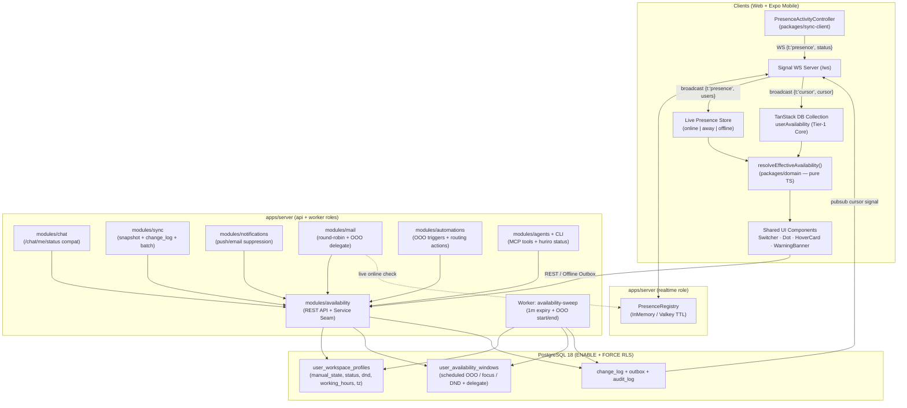

Here is the complete technical implementation plan for Huriro's shared **User Availability** feature. Please review and let me know if you'd like any adjustments before I proceed to implementation.

---

# Shared User Availability System — Implementation Plan

## Goal Description

Huriro currently has availability primitives fragmented across subsystems:
- `user_workspace_profiles` ([0028_m11_comms_parity.sql](file:///D:/1-Projects/Personal-projects/app-development/huriro/packages/db/migrations/0028_m11_comms_parity.sql)) stores `status_emoji`, `status_text`, `status_expires_at`, `dnd_until`, an untyped `working_hours` JSONB column, and `last_seen_at`, but is owned solely by `modules/chat` behind `GET/PUT /api/v1/chat/me/status` with no workspace-wide read API or TanStack DB sync collection.
- Ephemeral WebSocket presence (`online | away`) in [realtime/index.ts](file:///D:/1-Projects/Personal-projects/app-development/huriro/apps/server/src/realtime/index.ts) is wired only into web `useChatStore`, and neither web nor mobile ever calls `engine.sendPresence()` for auto-idle / background detection.
- [notifications/service.ts](file:///D:/1-Projects/Personal-projects/app-development/huriro/apps/server/src/modules/notifications/service.ts) and [notifications/digest.ts](file:///D:/1-Projects/Personal-projects/app-development/huriro/apps/server/src/modules/notifications/digest.ts) check `notification_preferences.quiet_hours_*` only, ignoring `dnd_until`, working hours, and Out-of-Office (OOO).
- [mail/advanced-mail-service.ts](file:///D:/1-Projects/Personal-projects/app-development/huriro/apps/server/src/modules/mail/advanced-mail-service.ts) checks `dnd_until` and `last_seen_at` (which only updates on status edits, not live presence) and ignores working hours and OOO delegates.

This plan promotes **User Availability** into a first-class, workspace-scoped, local-first platform feature shared across **Chat, Tasks, Mail, Docs, Inbox/Notifications, Automations, Settings, Web, Mobile, CLI, and MCP Agents**, while honoring every Huriro architectural invariant (`§4.2` tenant RLS, `§9.4` opaque cursor-only WS signals, `§15.2` ephemeral presence never persisted as DB heartbeats, `§17.2` five primary destinations, `<= 200 KB` gzip web entry shell, and `>= 60%` shared TypeScript client code).

### System Architecture



---

## User Review Required

> [!IMPORTANT]
> **New Leaf Server Module & Schema Ownership (`availability`)**:
> Creating `apps/server/src/modules/availability/` and `packages/db/src/schema/availability.ts` (registered in [dependency-cruiser.cjs](file:///D:/1-Projects/Personal-projects/app-development/huriro/packages/config/dependency-cruiser.cjs)) moves `userWorkspaceProfiles` out of `chat` into a shared leaf module so `chat`, `sync`, `notifications`, `mail`, `automations`, and `agents` all consume `availability` cleanly with zero circular dependencies. Existing `GET/PUT /api/v1/chat/me/status` routes stay intact as thin delegating wrappers.

> [!IMPORTANT]
> **Ephemeral Presence vs. Durable State (`§15.2` & `§9.4`)**:
> Per Huriro's rule *"presence is never a database row"*, live connection/idle heartbeats (`online | away`) remain ephemeral in a new `PresenceRegistry` (in-memory for `--role=all`, Valkey TTL keys when `VALKEY_URL` is configured). Durable user state (`manual_state`, custom status, DND timers, weekly working hours, scheduled OOO windows) lives in Postgres, syncs through Tier-1 `change_log` + TanStack DB, and fans out via opaque `{ t: "cursor" }` WebSocket signals.

> [!WARNING]
> **Safe Upgrade Defaults**:
> - `user_workspace_profiles.suppress_notifications_off_hours` defaults to `false` (off-hours suppression activates only when a user enables working hours and opts in).
> - `mail_inbox_routing_state.respect_working_hours` defaults to `false`, while `respect_ooo` and `use_ooo_delegate` default to `true`.
> - `REPLICA_SCHEMA_VERSION` in `packages/sync-client` bumps from `2` to `3` with a backward-compatible fallback (`snap.userAvailability ?? []`).

> [!NOTE]
> **Guest Visibility Isolation**:
> Active non-guest members (`owner`, `admin`, `member`) can read/sync all active workspace members' availability. Guests (`roleKey === 'guest'`) can only read/sync their own availability plus co-members sharing an accessible project or channel — preventing workspace directory enumeration.

---

## Proposed Changes

Ordered bottom-up by dependency layer.

---

### 1. Architecture Decision Record

#### [NEW] [0035-shared-user-availability-and-presence.md](file:///D:/1-Projects/Personal-projects/app-development/huriro/docs/adr/0035-shared-user-availability-and-presence.md)
Records the cross-cutting decisions: leaf module extraction (`availability`), ephemeral `PresenceRegistry` vs. durable Postgres state, deterministic precedence order, opaque cursor-only WS fan-out, guest visibility scoping, and notification/routing enforcement semantics.

---

### 2. Database Migration, Drizzle Schema & RLS Classification

#### [NEW] [0030_user_availability.sql](file:///D:/1-Projects/Personal-projects/app-development/huriro/packages/db/migrations/0030_user_availability.sql)
Expand-phase additive migration with documented rollback note:

```sql
-- 1. Expand user_workspace_profiles (ENABLE + FORCE RLS already enabled in 0028)
ALTER TABLE user_workspace_profiles
	ADD COLUMN manual_state text NOT NULL DEFAULT 'auto'
		CHECK (manual_state IN ('auto', 'available', 'busy', 'dnd', 'away', 'ooo')),
	ADD COLUMN manual_state_expires_at timestamptz,
	ADD COLUMN timezone text NOT NULL DEFAULT 'UTC',
	ADD COLUMN suppress_notifications_off_hours boolean NOT NULL DEFAULT false,
	ADD COLUMN allow_urgent_override boolean NOT NULL DEFAULT true,
	ADD COLUMN version int NOT NULL DEFAULT 1;

CREATE INDEX idx_uwp_expirations ON user_workspace_profiles (workspace_id)
	WHERE status_expires_at IS NOT NULL
		OR manual_state_expires_at IS NOT NULL
		OR dnd_until IS NOT NULL;

-- 2. Scheduled availability windows (OOO, focus blocks, scheduled DND)
CREATE TABLE user_availability_windows (
	id                       uuid PRIMARY KEY DEFAULT uuidv7(),
	workspace_id             uuid NOT NULL REFERENCES workspaces(id) ON DELETE CASCADE,
	user_id                  uuid NOT NULL REFERENCES users(id) ON DELETE CASCADE,
	kind                     text NOT NULL DEFAULT 'ooo'
		CHECK (kind IN ('ooo', 'focus', 'dnd')),
	title                    text NOT NULL DEFAULT '',
	message                  text NOT NULL DEFAULT '',
	starts_at                timestamptz NOT NULL,
	ends_at                  timestamptz NOT NULL,
	delegate_user_id         uuid REFERENCES users(id) ON DELETE SET NULL,
	auto_decline_routing     boolean NOT NULL DEFAULT true,
	suppress_notifications   boolean NOT NULL DEFAULT true,
	started_event_emitted_at timestamptz,
	ended_event_emitted_at   timestamptz,
	created_at               timestamptz NOT NULL DEFAULT now(),
	updated_at               timestamptz NOT NULL DEFAULT now(),
	version                  int NOT NULL DEFAULT 1,
	CHECK (ends_at > starts_at),
	CHECK (delegate_user_id IS NULL OR delegate_user_id <> user_id),
	UNIQUE (workspace_id, id)
);

CREATE INDEX idx_uaw_ws_user_range
	ON user_availability_windows (workspace_id, user_id, starts_at, ends_at);
CREATE INDEX idx_uaw_ws_active_end
	ON user_availability_windows (workspace_id, ends_at);
CREATE TRIGGER trg_user_availability_windows_updated_at
	BEFORE UPDATE ON user_availability_windows
	FOR EACH ROW EXECUTE FUNCTION set_updated_at();

ALTER TABLE user_availability_windows ENABLE ROW LEVEL SECURITY;
ALTER TABLE user_availability_windows FORCE ROW LEVEL SECURITY;
CREATE POLICY user_availability_windows_tenant_isolation ON user_availability_windows
	USING (workspace_id = NULLIF(current_setting('app.workspace_id', true), '')::uuid)
	WITH CHECK (workspace_id = NULLIF(current_setting('app.workspace_id', true), '')::uuid);

GRANT SELECT, INSERT, UPDATE, DELETE ON user_availability_windows TO huriro_app;
GRANT SELECT ON user_availability_windows TO huriro_maint;

-- 3. Expand mail_inbox_routing_state
ALTER TABLE mail_inbox_routing_state
	ADD COLUMN respect_working_hours boolean NOT NULL DEFAULT false,
	ADD COLUMN respect_ooo boolean NOT NULL DEFAULT true,
	ADD COLUMN use_ooo_delegate boolean NOT NULL DEFAULT true;

-- 4. Expand notification_delivery_log status CHECK for availability suppression reasons
-- (drops existing status CHECK via pg_constraint loop, then adds:)
ALTER TABLE notification_delivery_log
	ADD CONSTRAINT ck_notification_delivery_log_status
	CHECK (status IN (
		'pending', 'sent', 'skipped_quiet_hours', 'skipped_dnd',
		'skipped_ooo', 'skipped_off_hours', 'failed'
	));

-- 5. SECURITY DEFINER worker discovery helpers (narrow projections, granted only to huriro_app)
-- list_availability_expirations_due() -> (workspace_id, user_id)
-- list_availability_window_transitions_due() -> (workspace_id, id, transition)
```

#### [NEW] [availability.ts](file:///D:/1-Projects/Personal-projects/app-development/huriro/packages/db/src/schema/availability.ts)
Drizzle definitions for `userWorkspaceProfiles` (with new columns) and `userAvailabilityWindows`.

#### [MODIFY] [chat.ts](file:///D:/1-Projects/Personal-projects/app-development/huriro/packages/db/src/schema/chat.ts), [mail.ts](file:///D:/1-Projects/Personal-projects/app-development/huriro/packages/db/src/schema/mail.ts), [notifications.ts](file:///D:/1-Projects/Personal-projects/app-development/huriro/packages/db/src/schema/notifications.ts), [index.ts](file:///D:/1-Projects/Personal-projects/app-development/huriro/packages/db/src/index.ts)
- Move `userWorkspaceProfiles` export from `schema/chat.ts` to `schema/availability.ts` and export both tables from `packages/db/src/index.ts`.
- Add `respectWorkingHours`, `respectOoo`, `useOooDelegate` to `mailInboxRoutingState`.
- Widen `notificationDeliveryLog.status` enum.

#### [MODIFY] [rls.ts](file:///D:/1-Projects/Personal-projects/app-development/huriro/packages/test-utils/src/rls.ts)
- Add `'user_availability_windows'` to `TENANT_TABLES`.

---

### 3. Pure Domain Logic & Agent Scopes (`packages/domain`)

#### [NEW] [availability.ts](file:///D:/1-Projects/Personal-projects/app-development/huriro/packages/domain/src/availability.ts)
Zero-I/O pure TypeScript module shared across server, web, and mobile:
- **Typed Working Hours**:
  ```ts
  export type WeekdayKey = 'mon' | 'tue' | 'wed' | 'thu' | 'fri' | 'sat' | 'sun'
  export interface WorkingHoursInterval {
  	readonly start: string // HH:MM (24h)
  	readonly end: string   // HH:MM (strictly > start)
  }
  export interface WorkingHoursSchedule {
  	readonly enabled: boolean
  	readonly timezone: string // IANA tz
  	readonly days: Readonly<Record<WeekdayKey, readonly WorkingHoursInterval[]>>
  }
  ```
  - Supports multi-interval split shifts (up to 4 intervals/day), normalizes legacy `{}` JSONB, and validates via `Intl.DateTimeFormat`.
- **`resolveEffectiveAvailability({ profile, windows, livePresence, nowUtcIso })`**:
  Deterministic precedence order:
  1. Active `ooo` window (or unexpired manual `'ooo'`) → `state: 'ooo'`, `delegateUserId`, `isRoutable: !window.autoDeclineRouting`, `isAcceptingNotifications: !window.suppressNotifications`.
  2. Active DND (`dndUntil > now`, unexpired manual `'dnd'`, or active `'dnd'` window) → `state: 'dnd'`, `isRoutable: false`, `isAcceptingNotifications: false`.
  3. Active `'focus'` window or unexpired manual `'busy'` → `state: 'busy'`.
  4. Unexpired manual `'available'` or `'away'` → overrides idle/background auto-detection.
  5. Working hours enabled & outside schedule (`manualState === 'auto'`) → `state: 'off_hours'`, `withinWorkingHours: false`, `isRoutable: false`, `isAcceptingNotifications: !profile.suppressNotificationsOffHours`, `nextAvailableAt`.
  6. Live presence (`manualState === 'auto'`) → `'online' → 'available'`, `'away' → 'away'`, `'offline' → 'offline'`.
  - Strips expired `statusEmoji`/`statusText` if `statusExpiresAt <= nowUtcIso` and computes `localTimeLabel` (`HH:MM`) + `nextAvailableAt` (scanning up to 14 days respecting timezone/DST).
- **`evaluateNotificationSuppression(...)`**: unifies OOO, DND, off-hours, and `notification_preferences.quiet_hours_*`, respecting `allowUrgentOverride` for `approval.requested` and direct urgent mentions (except during OOO with `suppressNotifications: true`).
- **`buildAvailabilityWarning(effective, displayName)`**: builds structured non-blocking warning metadata (severity, i18n key + params, `delegateUserId`) shared by Web and Mobile.

#### [NEW] [availability.test.ts](file:///D:/1-Projects/Personal-projects/app-development/huriro/packages/domain/src/availability.test.ts)
Unit tests covering all 6 precedence tiers, DST/timezone boundaries, split shifts, urgent overrides, next-available computation, and legacy `{}` migration.

#### [MODIFY] [agent-scopes.ts](file:///D:/1-Projects/Personal-projects/app-development/huriro/packages/domain/src/agent-scopes.ts) & [index.ts](file:///D:/1-Projects/Personal-projects/app-development/huriro/packages/domain/src/index.ts)
- Add `'availability.write'` to `AGENT_SCOPES` (mapped to `[]` in `SCOPE_ACTIONS` — strictly self-scoped to the agent owner's own status in the handler; read tools reuse `'members.read'`).
- Re-export all availability helpers/types from `packages/domain/src/index.ts`.

---

### 4. Wire Contracts (`packages/contracts`)

#### [NEW] [availability.ts](file:///D:/1-Projects/Personal-projects/app-development/huriro/packages/contracts/src/availability.ts)
TypeBox schemas & types: `WorkingHoursIntervalSchema`, `WorkingHoursScheduleSchema`, `ManualAvailabilityStateSchema`, `EffectiveAvailabilityStateSchema`, `AvailabilityWindowKindSchema`, `AvailabilityWindowDto`, `CreateAvailabilityWindowBody`, `UpdateAvailabilityWindowBody`, `UserAvailabilityDto` (keyed by `id: userId` for TanStack DB, backward-compatible with `UserWorkspaceProfileDto`), `UpdateMyAvailabilityBody`, `ListWorkspaceAvailabilityQuery`, `ListWorkspaceAvailabilityResponse`, and agent tool input schemas (`AvailabilityListToolInput`, `AvailabilityGetToolInput`, `AvailabilitySetMyStatusToolInput`).

#### [MODIFY] [sync.ts](file:///D:/1-Projects/Personal-projects/app-development/huriro/packages/contracts/src/sync.ts), [mail.ts](file:///D:/1-Projects/Personal-projects/app-development/huriro/packages/contracts/src/mail.ts), [notifications.ts](file:///D:/1-Projects/Personal-projects/app-development/huriro/packages/contracts/src/notifications.ts), [automations.ts](file:///D:/1-Projects/Personal-projects/app-development/huriro/packages/contracts/src/automations.ts), [index.ts](file:///D:/1-Projects/Personal-projects/app-development/huriro/packages/contracts/src/index.ts)
- `sync.ts`: Add `'user_availability'` to `SyncEntityType` and `MutationEntity`; add optional `userAvailability` to `SyncSnapshotResponse`.
- `mail.ts`: Add `respectWorkingHours`, `respectOoo`, `useOooDelegate` to routing config schemas.
- `notifications.ts`: Widen delivery status union with `'skipped_dnd' | 'skipped_ooo' | 'skipped_off_hours'`.
- `automations.ts`: Add `'mail.route_round_robin'` action and optional `respectOooDelegate` flag on `issue.update` / `mail.assign`.
- `index.ts`: Export `./availability`.

---

### 5. Shared Sync Client & Presence Activity Controller (`packages/sync-client`)

#### [NEW] [presence-controller.ts](file:///D:/1-Projects/Personal-projects/app-development/huriro/packages/sync-client/src/presence-controller.ts) & [presence-controller.test.ts](file:///D:/1-Projects/Personal-projects/app-development/huriro/packages/sync-client/src/presence-controller.test.ts)
Platform-agnostic idle/away state machine shared by Web and Mobile:
- Transitions to `'away'` after `idleTimeoutMs` (default 5 min) of inactivity or `backgroundGraceMs` (default 30 s) when hidden/backgrounded; immediately restores `'online'` on activity/foreground.
- Replays current state on WS reconnect and throttles outbound `sendPresence` calls (`>= 5s` min gap) well under the 60/min WS rate limit.

#### [MODIFY] [collections.ts](file:///D:/1-Projects/Personal-projects/app-development/huriro/packages/sync-client/src/collections.ts), [engine.ts](file:///D:/1-Projects/Personal-projects/app-development/huriro/packages/sync-client/src/engine.ts), [index.ts](file:///D:/1-Projects/Personal-projects/app-development/huriro/packages/sync-client/src/index.ts)
- Add version-guarded `userAvailabilityManaged` collection (`collections.userAvailability`), bump `REPLICA_SCHEMA_VERSION = 3`, persist in `PersistedReplicaState`, hydrate in `applyFullSnapshot`, and apply `entity === 'user_availability'` deltas in `applyChanges()`.
- Add optimistic `engine.updateMyAvailability(patch)` enqueueing an offline-safe `user_availability` mutation.
- Export `PresenceActivityController`.

---

### 6. Server Core: `availability` Module, Boundaries & Realtime Presence Registry

#### [MODIFY] [dependency-cruiser.cjs](file:///D:/1-Projects/Personal-projects/app-development/huriro/packages/config/dependency-cruiser.cjs)
Add `availability: ['availability']` to `MODULE_SCHEMA_OWNERSHIP`.

#### [NEW] [presence-registry.ts](file:///D:/1-Projects/Personal-projects/app-development/huriro/apps/server/src/realtime/presence-registry.ts)
Ephemeral presence registry (`InMemoryPresenceRegistry` for `--role=all`/tests + `ValkeyPresenceRegistry` with 60s TTL keys `huriro:presence:<wsId>:<userId>` when `VALKEY_URL` is configured).

#### [MODIFY] [realtime/index.ts](file:///D:/1-Projects/Personal-projects/app-development/huriro/apps/server/src/realtime/index.ts) & [server/src/index.ts](file:///D:/1-Projects/Personal-projects/app-development/huriro/apps/server/src/index.ts)
Wire `presenceRegistry` into `startRealtime()`, `createApp()`, and `startWorker()`; update on `hello`, `presence`, `pong` heartbeat refresh, and final socket close.

#### [NEW] `apps/server/src/modules/availability/`
- `policy.ts`: Active member guard, guest co-member visibility resolver, self-or-`member.manage` authorization.
- `repo.ts`: Parameterized SQL for `user_workspace_profiles` and `user_availability_windows` inside `withWorkspace`.
- `service.ts`:
  - Validates `workingHours`, IANA `timezone`, non-overlapping `ooo` windows (`409`), and active non-guest `delegateUserId !== actor.userId` (`422`).
  - Atomic single-tx writes: domain row + `outbox` (`availability.updated.v1` / `availability.window.*`) + `audit_log` + `change_log` (`entity_type = 'user_availability'`, cursor allocated LAST) → returns `{ data, cursor }` for `pubsub.publishCursor`.
  - Cross-module service exports: `getMyAvailability`, `updateMyAvailability`, `listWorkspaceAvailability`, `getUserAvailability`, `getAvailabilitySnapshot`, `getUsersAvailabilityMap`, and window CRUD.
- `worker.ts`: `runAvailabilitySweepOnce(sql, pubsub?)` — every 60s clears expired statuses/DND/manual overrides and emits idempotent `availability.ooo.started.v1` / `availability.ooo.ended.v1` outbox events + `change_log` cursor bumps.
- `index.ts`: Elysia plugin exposing:
  - `GET /api/v1/availability`
  - `GET /api/v1/availability/me`
  - `PUT /api/v1/availability/me` (supports `Idempotency-Key` & optimistic `expectedVersion`)
  - `GET /api/v1/availability/users/:userId`
  - `GET /api/v1/availability/windows`
  - `POST /api/v1/availability/windows`
  - `PATCH /api/v1/availability/windows/:id`
  - `DELETE /api/v1/availability/windows/:id`

#### [MODIFY] [app.ts](file:///D:/1-Projects/Personal-projects/app-development/huriro/apps/server/src/api/app.ts) & [worker/index.ts](file:///D:/1-Projects/Personal-projects/app-development/huriro/apps/server/src/worker/index.ts)
Mount `availabilityModule` (with OpenAPI tag `'availability'`) and schedule pg-boss queue `'availability-sweep'` (`* * * * *`).

---

### 7. Server Cross-Pillar Integrations

#### [MODIFY] [advanced-chat-service.ts](file:///D:/1-Projects/Personal-projects/app-development/huriro/apps/server/src/modules/chat/advanced-chat-service.ts) & [chat/index.ts](file:///D:/1-Projects/Personal-projects/app-development/huriro/apps/server/src/modules/chat/index.ts)
Delegate `GET/PUT /api/v1/chat/me/status` to `availability` module's `getMyAvailability` / `updateMyAvailability` and publish the sync cursor.

#### [MODIFY] [sync/service.ts](file:///D:/1-Projects/Personal-projects/app-development/huriro/apps/server/src/modules/sync/service.ts)
- Include `userAvailability` in `getSyncSnapshot`.
- Filter `row.entityType === 'user_availability'` in `filterRowForActor` (enforcing guest visibility boundaries).
- Handle `m.entity === 'user_availability' && m.op === 'update'` in `runSingleMutation`.

#### [MODIFY] [notifications/service.ts](file:///D:/1-Projects/Personal-projects/app-development/huriro/apps/server/src/modules/notifications/service.ts) & [notifications/digest.ts](file:///D:/1-Projects/Personal-projects/app-development/huriro/apps/server/src/modules/notifications/digest.ts)
Evaluate `evaluateNotificationSuppression` using `getUsersAvailabilityMap` for web push, mobile push, instant email, and digest email while always persisting the durable in-app notification row and logging explicit `skipped_dnd` / `skipped_ooo` / `skipped_off_hours` / `skipped_quiet_hours` delivery reasons.

#### [MODIFY] [mail/advanced-mail-service.ts](file:///D:/1-Projects/Personal-projects/app-development/huriro/apps/server/src/modules/mail/advanced-mail-service.ts) & [mail/index.ts](file:///D:/1-Projects/Personal-projects/app-development/huriro/apps/server/src/modules/mail/index.ts)
Upgrade `getMailRoutingConfig`, `upsertMailRoutingConfig`, and `routeConversationRoundRobin` to evaluate unified availability (`respectDnd`, `respectOoo`, `respectWorkingHours`, `requireOnline` via `PresenceRegistry` with `ADR-0034` safe fallback) and support OOO delegate routing (`useOooDelegate`).

#### [MODIFY] [automations/executor.ts](file:///D:/1-Projects/Personal-projects/app-development/huriro/apps/server/src/modules/automations/executor.ts)
Support `{{userId}}` and `{{delegateUserId}}` template substitution for `availability.*` events, execute `mail.route_round_robin`, and honor `respectOooDelegate: true` on `issue.update` and `mail.assign`.

---

### 8. Agent Tools Registry & `huriro` CLI

#### [MODIFY] [registry.ts](file:///D:/1-Projects/Personal-projects/app-development/huriro/packages/agent-tools/src/registry.ts) & [tool-handlers.ts](file:///D:/1-Projects/Personal-projects/app-development/huriro/apps/server/src/modules/agents/tool-handlers.ts)
- Register & bind:
  1. `availability.list` (`scope: 'members.read'`, `R0`, `read`, `untrustedFields` tagged)
  2. `availability.get` (`scope: 'members.read'`, `R0`, `read`)
  3. `availability.set_my_status` (`scope: 'availability.write'`, `R1`, `write`, `undoable: true`, strictly scoped to agent owner)
- Enrich `workspace.describe` `members[]` with optional `availabilityState` & `delegateUserId`.

#### [MODIFY] [aliases.ts](file:///D:/1-Projects/Personal-projects/app-development/huriro/packages/cli/src/aliases.ts)
Add `huriro availability`, `huriro availability get <userId>`, and `huriro status set`, then run `bun run gen` to update `packages/cli/src/generated/commands.ts` and `docs/api/cli.md`.

---

### 9. Internationalization (`packages/i18n`)

#### [MODIFY] [en.ts](file:///D:/1-Projects/Personal-projects/app-development/huriro/packages/i18n/locales/en.ts)
Add `availability.*`, `settings.sidebar.availability`, `settings.desc.availability`, and `mail.routing.*` keys; regenerate [pseudo.ts](file:///D:/1-Projects/Personal-projects/app-development/huriro/packages/i18n/locales/pseudo.ts) via `bun run gen`.

---

### 10. Web Application (`apps/web`)

#### [NEW] `apps/web/src/features/availability/`
- `store/availability-store.ts`: Zustand store for `livePresenceByUser` and 60s `nowTick`.
- `hooks/use-availability.ts`: `useUserAvailability`, `useWorkspaceAvailabilityMap`, `useMyAvailability`, and `usePresenceAutoIdle(engine)`.
- `components/availability-dot.tsx`: WCAG 2.2 AA indicator using OKLCH semantic tokens (`bg-success`, `bg-warning`, `bg-destructive`, `bg-info`, `text-muted-foreground`) + shape/glyph distinction.
- `components/user-availability-card.tsx`: Popover/hover card showing state pill, custom status + expiry, teammate's local time, working hours, active/upcoming OOO dates, backup delegate, and quick Message action.
- `components/user-avatar-with-availability.tsx`: Composes shadcn [avatar.tsx](file:///D:/1-Projects/Personal-projects/app-development/huriro/apps/web/src/components/ui/avatar.tsx) + `AvailabilityDot` + optional `UserAvailabilityCard`.
- `components/availability-switcher.tsx`: Global quick-switcher in `SidebarFooter` (manual state override, status presets, DND duration timers, active OOO chip, deep link to `Settings → Availability`).
- `components/availability-warning-banner.tsx`: Non-blocking banner for OOO/DND/off-hours with 1-click **"Assign to backup (@name)"** button.
- `availability.test.tsx` & `availability.stories.tsx`.

#### [NEW] [availability-settings-panel.tsx](file:///D:/1-Projects/Personal-projects/app-development/huriro/apps/web/src/features/settings/components/availability-settings-panel.tsx)
Lazy-loaded personal settings section (`'availability'` in [settings-sections.ts](file:///D:/1-Projects/Personal-projects/app-development/huriro/apps/web/src/features/settings/settings-sections.ts), [ui-store.ts](file:///D:/1-Projects/Personal-projects/app-development/huriro/apps/web/src/stores/ui-store.ts), [settings-workspace.tsx](file:///D:/1-Projects/Personal-projects/app-development/huriro/apps/web/src/features/settings/components/settings-workspace.tsx)) with three cards: Current Override & Notification Rules, Weekly Working Hours Editor (timezone + split shifts + presets), and Scheduled OOO & Focus Blocks CRUD.

#### [MODIFY] Global Shell & Cross-Pillar Web Views
- [__root.tsx](file:///D:/1-Projects/Personal-projects/app-development/huriro/apps/web/src/routes/__root.tsx), [app-shell.tsx](file:///D:/1-Projects/Personal-projects/app-development/huriro/apps/web/src/components/app-shell/app-shell.tsx), [sidebar-footer.tsx](file:///D:/1-Projects/Personal-projects/app-development/huriro/apps/web/src/components/app-shell/sidebar/sidebar-footer.tsx): Mount `usePresenceAutoIdle`, route `onPresence` to `useAvailabilityStore`, embed `AvailabilityDot` + `AvailabilitySwitcher` in `SidebarFooter` (preserving the 5-destination law).
- [command-palette.tsx](file:///D:/1-Projects/Personal-projects/app-development/huriro/apps/web/src/features/search/components/command-palette.tsx): Add `Mod+K` commands for status, 1h DND toggle, and Availability settings.
- [api-bridge.ts](file:///D:/1-Projects/Personal-projects/app-development/huriro/apps/web/src/lib/api-bridge.ts) & [preview-workspace.ts](file:///D:/1-Projects/Personal-projects/app-development/huriro/apps/web/src/lib/preview-workspace.ts): Add availability REST + preview mock methods and seeded teammate states.
- **Chat** ([chat-sidebar-nav.tsx](file:///D:/1-Projects/Personal-projects/app-development/huriro/apps/web/src/features/chat/components/chat-sidebar-nav.tsx), [chat-workspace.tsx](file:///D:/1-Projects/Personal-projects/app-development/huriro/apps/web/src/features/chat/components/chat-workspace.tsx), [message-item.tsx](file:///D:/1-Projects/Personal-projects/app-development/huriro/apps/web/src/features/chat/components/message-item.tsx), [message-composer.tsx](file:///D:/1-Projects/Personal-projects/app-development/huriro/apps/web/src/features/chat/components/message-composer.tsx), [chat-store.ts](file:///D:/1-Projects/Personal-projects/app-development/huriro/apps/web/src/features/chat/store/chat-store.ts)): Unify status/presence onto shared availability, show teammate dots/hover cards on DMs/messages/mentions, and display OOO/DND banner in DM composer.
- **Tasks** ([task-list-view.tsx](file:///D:/1-Projects/Personal-projects/app-development/huriro/apps/web/src/features/tasks/components/task-list-view.tsx), [task-board-view.tsx](file:///D:/1-Projects/Personal-projects/app-development/huriro/apps/web/src/features/tasks/components/task-board-view.tsx), [task-detail-panel.tsx](file:///D:/1-Projects/Personal-projects/app-development/huriro/apps/web/src/features/tasks/components/task-detail-panel.tsx), [create-task-dialog.tsx](file:///D:/1-Projects/Personal-projects/app-development/huriro/apps/web/src/features/tasks/components/create-task-dialog.tsx)): Show assignee availability dots/hover cards and non-blocking `AvailabilityWarningBanner` with 1-click delegate swap.
- **Mail** ([conversation-view.tsx](file:///D:/1-Projects/Personal-projects/app-development/huriro/apps/web/src/features/mail/components/conversation-view.tsx), [mail-settings-panel.tsx](file:///D:/1-Projects/Personal-projects/app-development/huriro/apps/web/src/features/mail/components/mail-settings-panel.tsx)): Assignee availability dots + warning banner with delegate swap, plus new round-robin checkboxes (`respectWorkingHours`, `respectOoo`, `useOooDelegate`).
- **Docs** ([editor-shell.tsx](file:///D:/1-Projects/Personal-projects/app-development/huriro/apps/web/src/features/docs/components/editor-shell.tsx) & comments/mentions): Collaborator/author availability dots and OOO mention hints.
- **Settings → Members** ([members-settings-panel.tsx](file:///D:/1-Projects/Personal-projects/app-development/huriro/apps/web/src/features/settings/components/members-settings-panel.tsx)): Live availability badge, local time, custom status, and OOO/delegate column.

---

### 11. Mobile Application (`apps/mobile`)

#### [NEW] `apps/mobile/src/stores/availability-store.ts`, `apps/mobile/src/components/availability/`, and [availability.tsx](file:///D:/1-Projects/Personal-projects/app-development/huriro/apps/mobile/app/settings/availability.tsx)
- Zustand `useMobileAvailabilityStore` + Uniwind components (`MobileAvailabilityDot`, `MobileAvailabilitySheet`, `MobileAvailabilityWarning`).
- Dedicated `/settings/availability` screen for editing weekly working hours, timezone, off-hours suppression, and scheduled OOO windows.

#### [MODIFY] Mobile Wiring & Screens
- [workspace-bootstrap.ts](file:///D:/1-Projects/Personal-projects/app-development/huriro/apps/mobile/src/lib/workspace-bootstrap.ts), [runtime-context.tsx](file:///D:/1-Projects/Personal-projects/app-development/huriro/apps/mobile/src/lib/runtime-context.tsx), [api-client.ts](file:///D:/1-Projects/Personal-projects/app-development/huriro/apps/mobile/src/lib/api-client.ts): Wire `onPresence`, attach React Native `AppState` to `PresenceActivityController` (`engine.sendPresence`), seed preview availability, and expose availability REST methods.
- [mobile-status-bar.tsx](file:///D:/1-Projects/Personal-projects/app-development/huriro/apps/mobile/src/components/chat/mobile-status-bar.tsx) & [chat.tsx](file:///D:/1-Projects/Personal-projects/app-development/huriro/apps/mobile/app/(tabs)/chat.tsx): Upgrade status bar to open `MobileAvailabilitySheet`, show effective state dot + OOO chip, and surface peer availability on DMs.
- [settings.tsx](file:///D:/1-Projects/Personal-projects/app-development/huriro/apps/mobile/app/(tabs)/settings.tsx): Add Availability & Working Hours card with quick DND toggle and link to `/settings/availability`.
- [task/[id].tsx](file:///D:/1-Projects/Personal-projects/app-development/huriro/apps/mobile/app/task/[id].tsx) & [mail/[conversationId].tsx](file:///D:/1-Projects/Personal-projects/app-development/huriro/apps/mobile/app/mail/[conversationId].tsx): Display assignee `MobileAvailabilityDot` and `MobileAvailabilityWarning`.

---

## Verification Plan

### Automated Tests
1. **Domain & Sync-Client unit tests**:
   ```powershell
   bun test packages/domain/src/availability.test.ts packages/sync-client/src/presence-controller.test.ts packages/sync-client/src/collections-m8.test.ts packages/sync-client/src/sync-client.test.ts
   ```
2. **RLS & two-tenant isolation suite** (verifies `user_availability_windows` + `user_workspace_profiles` ENABLE/FORCE RLS & guest isolation):
   ```powershell
   bun test packages/test-utils
   ```
3. **Server integration tests** (new `apps/server/src/integration/availability.integration.test.ts` covering API CRUD, `/chat/me/status` compat, sync snapshot/delta/batch, `runAvailabilitySweepOnce` expirations & OOO start/end events, notification suppression delivery logs, Mail round-robin + OOO delegate routing, Automations `availability.ooo.started.v1`, and agent tools):
   ```powershell
   bun test apps/server/src/integration/availability.integration.test.ts apps/server/src/integration/sync-m7.integration.test.ts
   ```
4. **Web & Mobile UI tests**:
   ```powershell
   bun test apps/web/src/features/availability/availability.test.tsx apps/mobile/src/__tests__/mobile-core.test.ts
   ```
5. **Full platform CI gate** (lint, typecheck, test, build, `gen:check`, `check:boundaries`, `check:licenses`, `check:bundles <= 200 KB`, `check:shared-code >= 60%`):
   ```powershell
   bun run gen && bun run verify
   ```

### Manual Verification
1. **Live cross-pillar sync (Web)**: Change status/DND/override in Tab A's sidebar footer → confirm Tab B updates within ~1s across Chat, Tasks, Mail, Docs, and Settings → Members.
2. **Auto-idle & override precedence**: Background Tab A past idle threshold → confirm dot shifts to `Away` and snaps back to `Available` on focus; set manual `Busy` → confirm backgrounding does not overwrite manual override.
3. **Working hours & scheduled OOO**: Configure working hours + active OOO window with backup delegate in `Settings → Availability` → verify non-blocking warning banner with 1-click **"Assign to backup"** in Tasks/Mail, OOO banner in Chat DM composer, round-robin skipping/delegation in Mail, and `skipped_ooo` notification delivery logs while Inbox rows still arrive.
4. **Mobile & CLI**: Verify Expo Mobile status sheet, `AppState` presence transitions, Settings → Availability editor, and `huriro availability` / `huriro status set` CLI commands.

---

Would you like to approve this plan as written so I can begin implementation, or adjust any part of the design first?